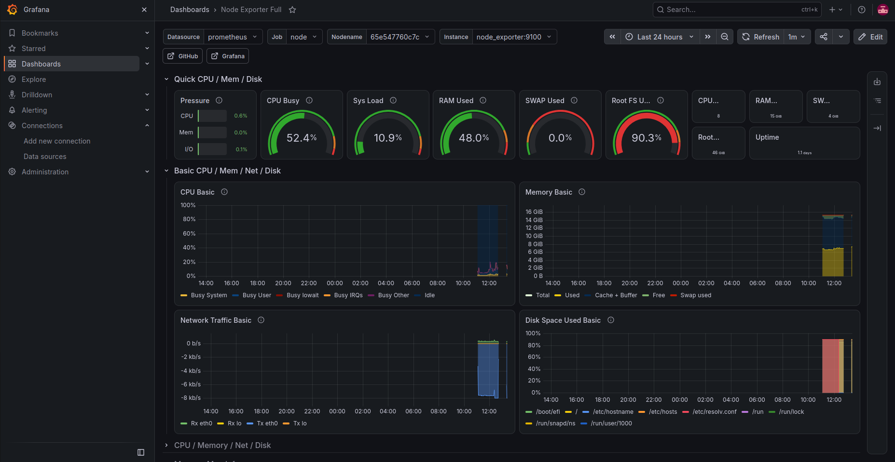

# Infra Monitor

A small monitoring project for a Linux machine. I built it in two steps to learn what monitoring tools really measure:

1. A **Bash script** with cron (simple, no tools)
2. **Prometheus + Grafana + node_exporter** with Docker Compose (the real tools)

## What it does

- Checks CPU, memory and disk usage
- Prints a WARNING when usage is too high (disk and CPU above 75%, memory above 80%)
- Saves results with a timestamp to a log file, every 5 minutes
- Shows the same metrics as live graphs in Grafana

## Part 1: Bash script + cron

`health_check.sh` reads:
- Memory from `free`
- Disk from `df`
- CPU from `top`

It uses `awk`, `tail` and `tr` to get the numbers, and `if` to warn when a value is too high.

Run it:

```bash
chmod +x health_check.sh
./health_check.sh
```

Run it every 5 minutes with cron (`crontab -e`):

```
*/5 * * * * /home/USER/infra-monitor/health_check.sh >> /home/USER/infra-monitor/health.log 2>&1
```

`>>` adds to the end of the log, and `2>&1` sends errors to the log too.

## Part 2: Prometheus + Grafana

| Tool | Job |
|---|---|
| node_exporter | Reads CPU, memory and disk from the machine |
| Prometheus | Collects the numbers every 15 seconds and stores them |
| Grafana | Shows them as dashboards |

Start everything:

```bash
cd monitoring
docker compose up -d
```

Then open:
- Prometheus: http://localhost:9090 (check Status > Targets shows UP)
- Grafana: http://localhost:3000 (login: admin / admin)

In Grafana:
1. Add a Prometheus data source with URL `http://prometheus:9090`
2. Import dashboard ID `1860` (Node Exporter Full)

## Screenshot



## What I learned

- Containers talk to each other by **service name**, not `localhost`.
- node_exporter in a container sees the container's disk, not the host's. I fixed it by mounting the host `/` as read-only and using `--path.rootfs=/host`.
- Building the Bash version first helped me understand what Prometheus actually measures.
- The monitoring found a real problem: my root disk was at 90%.
- Grafana, Prometheus and Alertmanager are bound to 127.0.0.1. node_exporter is not published, because Prometheus reaches it through the Docker network.
## Next steps

- [ ] Alerts with Alertmanager
- [ ] Run the stack on Kubernetes (minikube)
- [ ] Add a Dockerfile and a GitHub Actions workflow

## Tech

Bash, cron, Linux, Docker, Docker Compose, Prometheus, Grafana, node_exporter
